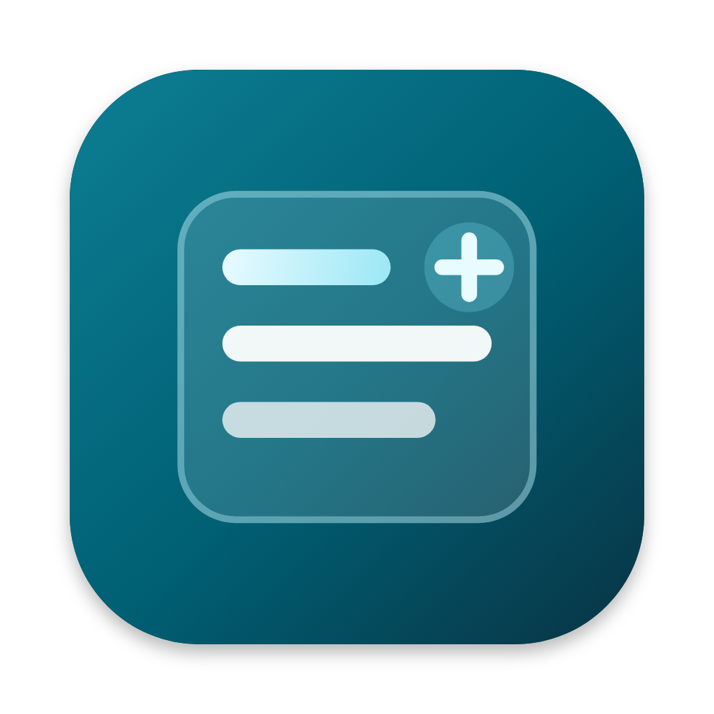

# WLSAPlus · macOS

[](https://github.com/yezicheng2011/wlsaplus-enablemacos/releases/latest)

> **Final feature release: 99.99.99.0**
>
> This is the final feature release of the project. There will be no further software or feature updates. Only the VPN will continue to be maintained. Those VPN maintenance versions will be numbered **99.99.99.1**, **99.99.99.2**, and so on.
>
> 这是本项目的最终功能版本 **99.99.99.0**：之后不再更新软件功能，只继续维护 VPN，维护版本为 99.99.99.1、99.99.99.2，依此类推。

> **VPN is unlimited for normal personal use.** Fair use is counted only on this Mac, not as a server quota. If one installation transfers more than **50 GB in a rolling 24 hours** or **500 GB in a rolling 30 days**, the tunnel slows to about **5 Mbps** for upload and download combined until the window drops back under the limit. The VPN stays connected; fair use never disconnects it. Normal classwork, browsing, and video are expected. The limit is there so a node is not used as a download box.

<p align="center">
  
</p>

<p align="center">
  A local-first schedule &amp; study app for WLSA students<br>
  <b>macOS 13+ · Universal (Intel x86_64 + Apple silicon arm64)</b> · Native Swift / C
</p>

<p align="center">
  <a href="#official-download">Official download</a> ·
  <a href="#build-from-source">Build from source</a> ·
  <a href="release-kit/wlsaplusmac版本说明书.md">Manual</a> ·
  <a href="https://wlsaplus.spacehubxyz.hk/#download">Official site</a> ·
  <a href="native/README.md">Native docs</a>
</p>

> **Current product**  
> The macOS client has been fully rewritten as an **independent native** app (Swift / C; system AppKit, WebKit, Network, CryptoKit, and related frameworks).  
>  
> **Other platforms**  
> This macOS edition is an independent product line and does **not** share code or runtime with the Windows / Android editions.  
>  
> **Network & VPN core**  
> The VPN core is **MockMini, our own open-source engine** ([Apache-2.0](LICENSE); site [mockmini.danielye2011.uk](https://mockmini.danielye2011.uk/)), built on system utun + Network.framework + CryptoKit/CommonCrypto. It **no longer uses** the former shared core (mihomo / Clash Meta) or any third-party VPN runtime.  
>  
> **How to install (important)**  
> **End users should build from source** using the steps below and the [manual](release-kit/wlsaplusmac版本说明书.md). GitHub Releases are mainly for developer self-testing and the in-app update channel — they are **not** the primary install path for classmates.

---

## About

WLSAPlus brings your PowerSchool schedule, grades, attendance, class reminders, campus tools and the WLSAPlus forum into one native Mac app. Data stays on your Mac, and the last sync is available offline.

> This repository ships the **macOS** client only; it is independent of the Windows and Android editions.

## Features

| Feature | Description |
|---|---|
| 💬 **WLSAPlus Forum** | Embedded forum; **auto sign-in** with the current PowerSchool session (your password never leaves the Mac; posts stay anonymous); **light/dark follows the app theme**; embed mode uses the forum's **bottom navigation** |
| 📅 **Schedule** | Synced from PowerSchool, cached locally, works offline |
| 📈 **Progress** | Course grades, assignment scores, attendance |
| 🔔 **Reminders** | macOS notification about 5 minutes before class (optional) |
| 🛡️ **VPN** | Subscription nodes, latency test, full-device tunnel; the core is **MockMini, our own open-source engine** (Apache-2.0) |
| 🧰 **Tools** | Campus map, translator, to-dos |
| 🎨 **Appearance** | System / light / dark, multiple accent colours |
| 🤖 **Assistant** | On Apple silicon Macs with 16 GB+ memory: ask in Chinese or English about class times, grades, rooms and teachers. Answers are read from your synced data; a small language model runs on the Mac and nothing leaves it |
| 🌐 **Language** | English or Chinese interface, or follow the system |
| 🖼️ **App icon** | Dock / Finder icon for Intel and Apple silicon; on macOS 26 it follows the Default, Dark, Clear and Tinted icon styles (official builds; source builds need Xcode 26 for those styles) |

## Official download

The official installer for **99.99.99.0** is `WLSAPlus-99.99.99.0-macOS-universal.pkg`. It installs `WLSAPlus.app` into `/Applications` on Intel and Apple silicon. Open the package from the Finder (right-click → Open). It is signed with this project's certificate, so Gatekeeper may say the developer cannot be verified; that is expected and is not a "damaged" package. In-app updates still download a zip, not the pkg. A disk image is also published. Classmates can keep building from source with the commands below.

## Build from source

**Building from source is still the path that needs no download.** No Apple Developer account is needed, and no Node / npm / Homebrew for a normal build. `scripts/build.sh` also writes `out/WLSAPlus-99.99.99.0-macOS-universal.pkg`. That local package is unsigned unless `WLSAPLUS_SIGN_IDENTITY` is set. A release run signs it with the pinned identity `764D4389AAFA0C50311E39C17DDFA1981ABEF86C`.

### Requirements

- macOS **13** or later (Intel or Apple silicon)
- **Xcode Command Line Tools** installed (if not, run `xcode-select --install` in Terminal and follow the prompts)

### Commands (copy the whole block)

On networks in mainland China, clone through the **gh-proxy.com** mirror first (don't confuse it with `ghproxy.com`, which is often blocked). As fallbacks, swap the host for `ghproxy.net` or `ghfast.top` (same path).

```bash
# 1) Clone the repository (mirror recommended in mainland China)
git clone https://gh-proxy.com/https://github.com/yezicheng2011/wlsaplus-enablemacos.git
cd wlsaplus-enablemacos

# 2) Enter the native project and build (universal: arm64 + x86_64)
cd native
WLSAPLUS_VERSION=99.99.99.0 bash scripts/build.sh

# 3) Open the freshly built app
open out/WLSAPlus.app
```

The four core lines classmates can copy (mirror clone + build + open):

```bash
git clone https://gh-proxy.com/https://github.com/yezicheng2011/wlsaplus-enablemacos.git
cd wlsaplus-enablemacos/native
WLSAPLUS_VERSION=99.99.99.0 bash scripts/build.sh
open out/WLSAPlus.app
```

If `git clone` still fails, download the zip through the same mirror:

```bash
curl -L -o wlsaplus-enablemacos.zip 'https://gh-proxy.com/https://github.com/yezicheng2011/wlsaplus-enablemacos/archive/refs/heads/main.zip'
unzip wlsaplus-enablemacos.zip
cd wlsaplus-enablemacos-main/native
WLSAPLUS_VERSION=99.99.99.0 bash scripts/build.sh
open out/WLSAPlus.app
```

If you can reach GitHub directly, use `https://github.com/yezicheng2011/wlsaplus-enablemacos.git` instead.

Optional: install into Applications and clear the quarantine flag (reduces false "damaged" warnings):

```bash
ditto out/WLSAPlus.app /Applications/WLSAPlus.app
xattr -cr /Applications/WLSAPlus.app
open /Applications/WLSAPlus.app
```

Even easier: after cloning, double-click [`release-kit/编译wlsaplus.command`](release-kit/编译wlsaplus.command) in the repository (it checks the command line tools → builds → opens the app). See the [manual](release-kit/wlsaplusmac版本说明书.md) for full step-by-step instructions.

### "Developer cannot be verified / not safe" on first launch (Gatekeeper)

Builds use **ad-hoc / project self-signing** by default; an Apple Developer ID or notarization is **neither needed nor required**. Other people opening the app will usually see "developer cannot be verified" or "not safe". **Just do the following** (this is expected and does not mean the build failed):

- In Finder, **right-click `WLSAPlus.app` → Open → Open**, or go to **System Settings → Privacy & Security → Open Anyway**
- If it still says the app is "damaged", run in Terminal:

```bash
xattr -cr /Applications/WLSAPlus.app
# If the app is still in the out/ directory:
# xattr -cr "$(pwd)/out/WLSAPlus.app"
```

### Optional tests

The full test suite also needs `node` and `python3` on your Mac (you do **not** need to run it just to install the app):

```bash
cd native
bash scripts/test.sh
```

From the repository root, zero-dependency Node scripts in `package.json` (`Apache-2.0`) also run the JavaScript/wire-contract suite and license compliance check without installing third-party npm packages:

```bash
npm run verify:license
npm run test:js
```

## Development

| Path | Description |
|---|---|
| [`native/`](native/) | **Native macOS client & MockMini VPN engine** (Swift / C, local WebKit UI, tests, and build scripts) |
| [`release-kit/`](release-kit/) | One-click source-build helper script and user manual |
| `package.json` | Zero-dependency root task runner (`Apache-2.0`) |

CI:

- **Native check** (`native-check.yml`)
- **Build and release native macOS app** (`release.yml`): builds from `native/`; stable releases can be created as drafts and then marked Latest (for in-app updates)

Optional signing / notarization secrets (for maintainer releases only; classmates building the app don't need them):

| Purpose | Secrets |
|---|---|
| Code signing | `APPLE_CERTIFICATE_BASE64`, `APPLE_CERTIFICATE_PASSWORD`, `APPLE_IDENTITY` |
| Notarization | `APPLE_ID`, `APPLE_APP_PASSWORD`, `APPLE_TEAM_ID` |
| In-app update signing | `WLSAPLUS_UPDATE_ED25519_KEY` |

See [native/README.md](native/README.md) and [native/PROVENANCE.md](native/PROVENANCE.md) for details.

## Privacy

- Schedules, grades and to-dos are stored on your Mac; your PowerSchool password is kept in the system Keychain / system encrypted storage.
- Forum auto sign-in only hands the current PowerSchool session cookies (allow-listed) to the forum server for one-time verification and never sends your password; the forum runs in an isolated WebKit data store.

## License

The entire repository is licensed under the **Apache License 2.0**; see [`LICENSE`](LICENSE) and [`NOTICE`](NOTICE). Platform and attribution notes are listed in [`THIRD_PARTY_NOTICES.md`](THIRD_PARTY_NOTICES.md).

For the origin and rights boundaries of the native codebase, see [`native/PROVENANCE.md`](native/PROVENANCE.md). Historical 1.x Electron/Angular files and the former third-party VPN core binary have been retired and removed from this repository.

© daniel.ye叶子诚
